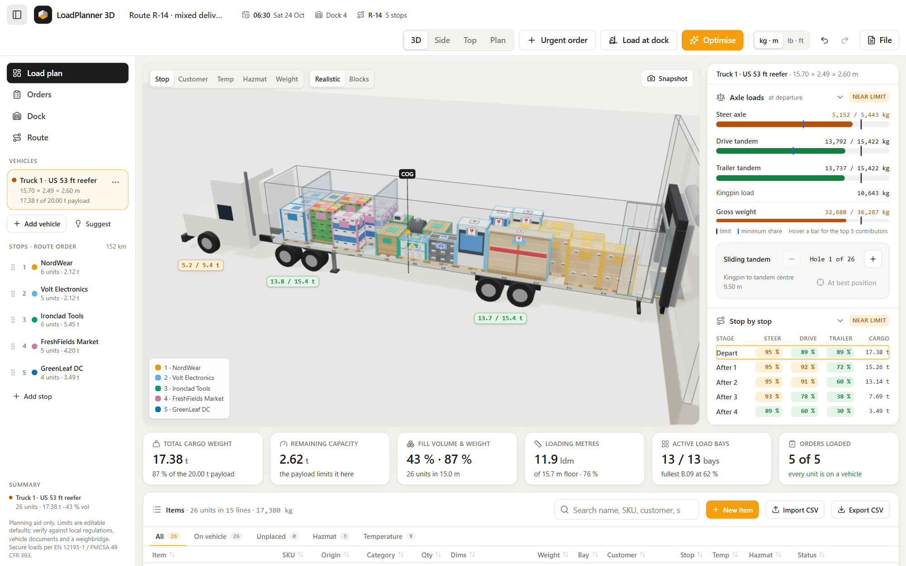

# LoadPlanner 3D

Plan truck, trailer and container loads in 3D, in the browser. Define your cargo (dimensions, weight, centre of gravity, stacking, temperature, hazmat), pick a vehicle, and the app packs it, checks every axle at departure **and after every delivery stop**, and lets you drag freight around while every number updates live.

**Live app:** https://riandra4trend.github.io/cargo-load-planner/



> Planning aid only. Limits are editable defaults; verify against local regulations, vehicle documents and a weighbridge. Secure loads per EN 12195-1 / FMCSA 49 CFR 393.

## What it does

**Cargo objects**
- Item editor with live 3D preview: L × W × H in mm/cm/m/in/ft, weight in kg/t/lb, quantity, packaging presets (EUR / half / industrial / US GMA pallets, carton, crate, 200 L drum, IBC, 20 L jerrycan, long goods), palletized height, centre-of-gravity offset, stackable, max load on top, max layers, fragile, keep upright, allowed rotations, temperature class, food flag, hazmat (UN number, class, packing group), and a liquid mode that calculates the weight from volume × density.
- Live derived values (volume, density, footprint, loading metres) and a fit check against every vehicle and door.
- 35 built-in templates (12 of them liquids) plus your own template library; CSV import (paste straight from Excel/Sheets, automatic column mapping, inch/lb and gal conversion, liquid and volume columns, per-row error report) and CSV export.

**Vehicles**
- Presets: EU van 3.5 t, EU box truck 18 t, EU 13.6 m curtainsider, US 53 ft dry van, US 53 ft multi-temp reefer, 40 ft high-cube container, US 48 ft flatbed, and five tankers (16,000 L rigid fuel tanker, 32,000 L semi fuel tanker, 8,000 L water tanker, 24,000 L insulated food-grade tanker, 44,000 L pressurised LPG tanker). All values are approximate and editable.
- Custom vehicle editor (rigid or tractor + semi-trailer) with a live side-view schematic and load distribution curve.
- Several vehicles per plan; "Suggest" proposes the fewest vehicles that carry everything.

**Physics and checks**
- Axle loads for rigid vehicles and two-stage tractor/trailer statics (kingpin → steer/drive), at departure and after each stop.
- Load distribution diagram (max legal payload vs. COG position), remaining capacity with the limiting factor, sliding tandem with a "best hole" search, US Federal Bridge Formula, floor (running-metre) load, left/right balance, COG height.
- Hard rules: inside the cargo space, through the door, no overlap, ceiling and reefer airflow clearance, support ≥ 75 %, stacking limits, fragile, rotation, temperature zones, hazmat segregation (illustrative matrix) and food separation.
- Soft rules: axle/gross/payload limits at every stage, last-stop-first loading ("Batteries (stop 2) blocks stop 1"), balance, floor load. Fix suggestions apply in one click (e.g. "Slide trailer tandem 25 holes forward").

**Fuel and emissions**
- Diesel estimate per vehicle and per leg. Each leg burns at the consumption for the cargo still aboard, so the trucks use less as deliveries come off. Consumption is linear between the vehicle's empty and full-payload figures (L/100 km, or mpg in imperial).
- Adds the reefer unit while chilled or frozen cargo is aboard (driving and at stops), engine idling at each stop, and an empty return to the depot.
- Shows cost in any currency, CO₂, time on the road, tank use and freight efficiency (L per 100 t·km or ton-mi/gal) in the right panel, as a KPI card and in the report.
- Leg distances are entered per stop in the sidebar. Fuel profiles are edited in the vehicle editor; price, CO₂ factor, average speed and stop times in Settings.

**Liquid cargo**
- Liquid library with 21 liquids, each with its density at 15 °C, UN number and class where it is dangerous goods, food flag, temperature class and maximum fill. It covers water, drinking water, seawater, diesel, gasoline, kerosene, Jet A-1, crude oil, lube oil, palm oil, vegetable oil, milk, fruit juice, molasses, ethanol, methanol, sulfuric acid, hydrochloric acid, caustic soda, liquid fertilizer and LPG. Custom liquids take any density.
- Weight is volume × density: 1,000 L of water weighs 1,000 kg, diesel 840 kg, gasoline 740 kg, palm oil 910 kg, sulfuric acid 1,840 kg. The Liquid weights reference compares all of them and converts any volume (L or US gal) to weight.
- Packaged liquids (200 L drums, 1,000 L IBC totes, 20 L jerrycans) ride on any vehicle; the weight includes the container tare, and the editor checks the container capacity.
- Bulk liquids ride in tanker compartments. Each fill acts at its compartment, so the axle loads change at every station as compartments are emptied.
- Tank rules: maximum fill per liquid (97 % for fuels, 85 % for LPG), one product per compartment, food-grade tanks for food, insulated tanks for chilled liquids, pressure vessels for LPG, hazmat separation between compartments, and a surge warning for part-full compartments in unbaffled tanks. The optimiser assigns fills to compartments so every axle stays legal at every stop.
- File → Sample: fuel delivery loads a 32,000 L tanker delivering diesel and gasoline to three stations.

**Optimiser**
- 3D extreme-point packing plus seeded local search in a Web Worker (3 s budget, progress, cancel). It sizes the multi-temp bulkheads, picks the slider hole and respects pinned units.
- Shows a before/after diff with Accept / Revert. Unplaced units get reasons, and "Add a second vehicle" picks a vehicle that can carry the leftovers.
- Urgent orders re-plan in stable mode (keeps existing placements where possible).

**3D and simulations**
- React-three-fiber scene with tractor/trailer models, wheels at the real axle positions, temperature zones, bulkheads, bays, COG marker, axle labels and violation callouts.
- Cargo is drawn as realistic goods, all generated from primitives to fit each item's exact dimensions:
  - wooden pallets with taped, labelled cartons under stretch film
  - frost-wrapped frozen goods, dairy and produce crates, beverage packs
  - paint pails, battery packs, boxed TVs
  - plank crates and glass crates, machines on skids, strapped steel bundles
  - drums, paper rolls, cable reels, IBC totes

  Stop colours show on corner boards and labels. A Blocks mode switches to plain coloured boxes for analysis.
- Drag to move or stack (R rotates, Esc cancels); illegal drops show a red ghost with the reasons. Side and top views are orthographic; the Plan view is a printable dimensioned floor plan + side elevation.
- Colour by stop, customer, temperature, hazmat or weight.
- "Load at dock": an animated forklift loads the plan from colour-coded staging lanes, with a numbered step list. The unload simulation steps through the stops.

**Files and sharing**
- Autosave, named plans, JSON export/import (exact round trip), share links (plan compressed into the URL), print/PDF report, PNG snapshot, undo/redo, metric/imperial toggle everywhere.

## Run it locally

Requires Node 20+ (developed on Node 24).

```bash
npm install
npm run dev        # http://localhost:5173
npm test           # physics, rules, optimiser, IO, scene and item tests
npm run build      # static site in dist/
npm run preview    # serve the production build
```

Keyboard: `R` rotate · `Delete` remove from vehicle · `Ctrl+Z` / `Ctrl+Y` undo/redo · `F` focus selection · `1`–`4` views · `Space` play/pause simulation · `Esc` cancel/clear.

## How the physics works

Every axle group's load is affine in the cargo: `load_i = tare_i + Σ kg_j · share_i(x_j)`.

- **Rigid vehicle:** the front and rear axle groups are the supports. A load *W* at distance *a* behind the front axle, with wheelbase *L*, puts *W·a/L* on the rear group and *W − W·a/L* on the front. This also holds behind the rear axle, where the front axle is unloaded.
- **Tractor + semi-trailer:** trailer loads resolve onto the kingpin and the trailer axle group (moments about the kingpin). The kingpin load then resolves onto the steer and drive groups from the fifth-wheel position.
- **Load distribution curve:** for every COG position it takes the minimum over the payload, the gross limit, each axle maximum and each axle minimum share.

The tests pin these with hand-computed cases. For example, 1000 kg at x = 5 m on a trailer with the kingpin at 1 m and the tandem at 11 m gives 600 kg on the kingpin and 400 kg on the tandem, which becomes 47.37 kg steer / 552.63 kg drive.

Fuel per leg = distance × (empty + (full − empty) × cargo aboard / rated payload) / 100. The reefer runs for the driving and stop time while chilled or frozen cargo is aboard; idling adds the idle rate × idle minutes at every stop. Cost and CO₂ multiply the total litres by the price and the CO₂ factor (default 2.68 kg/L, fossil diesel).

A bulk liquid fill weighs volume × density and acts at its compartment's centre along the tank, on the centreline, at half the liquid height. When a station's compartments are emptied, the next stage is computed without them.

## Project structure

```
src/
  domain/    types (shared contract), units, geometry, presets (incl. tankers), liquids library, settings, colours
  physics/   axle statics, stages, load distribution, capacity, Bridge Formula, slider, fuel estimate
  rules/     hard/soft checks, LIFO, support/stacking, hazmat, fix suggestions, validateMove
  packing/   construction + local search optimiser, Web Worker, findPlacementFor, proposeVehicles
  state/     Zustand store (undo/redo), plan evaluation, hooks
  scene/     react-three-fiber viewport, vehicle/cargo models, drag, camera, simulations
  ui/        shell (top bar, panels, KPIs, plan view, dialogs), data (item table/editor), io dialogs
  io/        JSON, CSV, share links, persistence, bootstrap
  data/      seed scenario, item templates, packaging presets, empty plan
  sim/       loading sequence
```

## Assumptions and limitations

- Vehicle presets, tare axle loads and limits are typical illustrative values, not manufacturer data. Edit them to match your registration papers.
- The hazmat compatibility matrix is illustrative, loosely based on ADR 7.5.2 / 49 CFR 177.848. It is not a legal reference.
- Cylinders are packed by their bounding boxes. The optimiser is heuristic: good, not provably optimal. With a fixed seed and an iteration cap (`maxIterations`) its result is reproducible; with only a time budget it depends on machine speed.
- Fuel figures are typical values and the model ignores terrain, speed profile, traffic and weather; it is a planning estimate, not a fuel card.
- Liquid densities are typical values at 15 °C; thermal expansion (volume correction) is ignored. The liquid's centre-of-gravity height uses a simplified tank cross-section, and surge is a rule of thumb, not a dynamic simulation.
- Not certified for legal compliance. Load securing (lashing) is out of scope.
